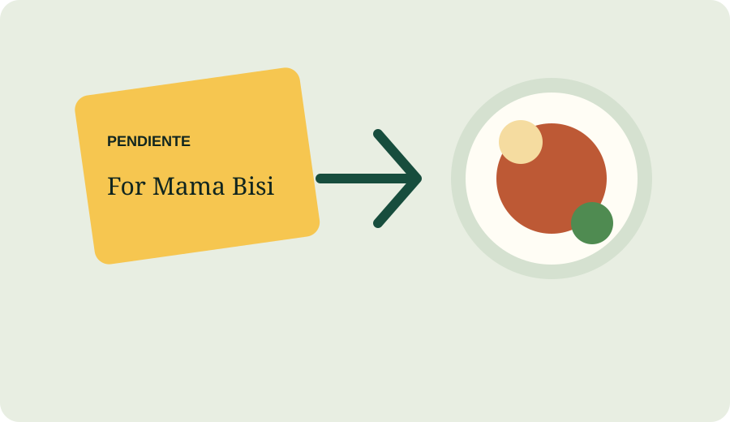

# Pendiente

Buy a meal for someone back home. The stall only gets paid when the plate is served.



Try it: [live site](https://pendiente.example) · [practice mode](http://localhost:5173) · [proof page](http://localhost:5173/proof)

## How it works

1. **Buy.** Choose a stall, add a first name, and approve $3.00.
2. **Card.** Send the paper meal card on WhatsApp or print it.
3. **Scan.** The stall scans the card when the plate is ready.
4. **Paid.** The stall receives the meal price. You see the plate photo.

## Why Stellar

- The fee is under one cent.
- The stall is paid in about 5 seconds.
- Anyone can check the public payment record.

## What is real

This build starts in practice mode with play money. Real meals served: 0. The proof page will link each real meal after the stall filming day.

## Run it locally

```sh
npm install
npm run dev:all
```

Open `http://localhost:5173`. The server uses SQLite and the browser falls back to local practice data when the server is not running.

## Under the hood

The locker is a Stellar smart contract (a small program on Stellar that nobody can change). It holds USDC (digital dollars) for each meal. A React and TypeScript site creates cards and shows status. A Node server stores stall details and plate photos in SQLite. The server sends the serve and refund calls and pays their tiny network fee. Card secrets stay in the buyer’s browser and on the paper card. The public meal page never includes a secret.
